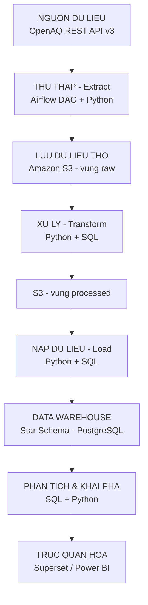
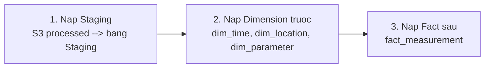
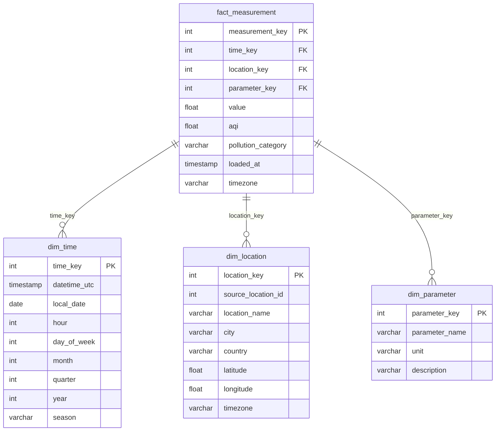

# KE HOACH DU AN CHI TIET
## Xay dung he thong Data Warehouse va ETL phuc vu phan tich chat luong khong khi tu du lieu OpenAQ

---

## 1. Tong quan du an

| Hang muc | Chi tiet |
|----------|---------|
| **Ten de tai** | Xay dung he thong Data Warehouse va ETL phuc vu phan tich chat luong khong khi tu du lieu OpenAQ |
| **Nguon du lieu** | OpenAQ API v3 (`https://api.openaq.org/v3/`) |
| **Mo hinh DW** | Star Schema (1 Fact + 3 Dimension) |
| **Cong nghe ETL** | Apache Airflow + Python |
| **Luu tru Raw** | Amazon S3 |
| **CSDL DW** | PostgreSQL |
| **Truc quan hoa** | Apache Superset / Power BI |

---

## 2. Kien truc tong the (theo so do Workflow)



---

## 3. Chi tiet tung tang (Layer)

### 3.1. Tang 1: Nguon du lieu - OpenAQ API v3

**Base URL:** `https://api.openaq.org/v3/`

| Endpoint | Muc dich | Ghi chu |
|----------|---------|---------|
| `GET /v3/locations` | Lay danh sach tram do | Loc theo `iso`, `countries_id`, `parameters_id`, `bbox`, `coordinates` |
| `GET /v3/locations/{id}` | Chi tiet 1 tram | Bao gom sensors list |
| `GET /v3/sensors/{id}/measurements` | Do luong raw cua sensor | Loc theo `datetime_from`, `datetime_to`, phan trang `page`, `limit` (max 100) |
| `GET /v3/sensors/{id}/hours` | Do luong trung binh theo gio (precomputed) | **Khuyen dung** - hieu nang tot hon `/measurements/hourly` |
| `GET /v3/sensors/{id}/hours/daily` | Tong hop tu gio len ngay | |
| `GET /v3/sensors/{id}/hours/monthly` | Tong hop tu gio len thang | |
| `GET /v3/sensors/{id}/hours/yearly` | Tong hop tu gio len nam | |
| `GET /v3/sensors/{id}/hours/hourofday` | Trung binh theo gio trong ngay | Phan tich pattern gio |
| `GET /v3/sensors/{id}/hours/dayofweek` | Trung binh theo ngay trong tuan | Phan tich pattern tuan |
| `GET /v3/parameters` | Danh sach cac thong so do | PM2.5, PM10, O3, NO2, SO2, CO... |
| `GET /v3/countries` | Danh sach quoc gia | |
| `GET /v3/instruments` | Danh sach thiet bi do | |
| `GET /v3/manufacturers` | Nha san xuat thiet bi | |

> [!IMPORTANT]
> **Xac thuc:** API yeu cau API Key thong qua header `X-API-Key`. Can dang ky tai [https://explore.openaq.org](https://explore.openaq.org) de lay key.
> **Rate limit:** API co gioi han so luong request. Can implement retry logic voi exponential backoff.
> **Phan trang:** Moi request toi da `limit=100` ban ghi. Can lap (loop) qua cac trang (`page=1,2,3,...`).

---

### 3.2. Tang 2: Thu thap du lieu (Extract) - Airflow DAG

**Cong nghe:** Apache Airflow + Python (`requests` / `httpx`)

#### DAG chinh: `openaq_extract_dag`

| Task | Mo ta | Chi tiet ky thuat |
|------|-------|-------------------|
| `fetch_locations` | Lay danh sach locations & sensors | - Goi `GET /v3/locations?iso=VN&limit=100&page={n}`<br/>- Lap qua tat ca trang den khi het<br/>- Lay `sensors` list tu moi location |
| `fetch_measurements` | Goi measurements cho tung sensor | - Goi `GET /v3/sensors/{id}/measurements`<br/>- Loc theo `datetime_from`/`datetime_to` (tu moc thoi gian truoc den hien tai)<br/>- Xu ly phan trang: `page=1..N`<br/>- **Retry** khi loi (503, timeout) voi backoff |
| `save_to_s3_raw` | Ghi JSON len S3 | - Duong dan: `s3://bucket/raw/openaq/{yyyy}/{mm}/{dd}/`<br/>- Ghi nguyen JSON, khong chinh sua<br/>- Log so ban ghi da doc |

#### Lich chay DAG:

| Tan suat | Mo ta |
|----------|-------|
| **Hang ngay** (1 lan/ngay, 2:00 AM UTC) | Thu thap measurements cua ngay hom truoc |
| **Hang tuan** (Chu nhat, 3:00 AM UTC) | Dong bo lai danh sach locations/sensors (phat hien tram moi) |
| **Lan dau (Backfill)** | Chay 1 lan de thu thap du lieu lich su (6-12 thang truoc) |

#### Logic xu ly loi:

```
retry_policy:
  max_retries: 3
  delay: 30s (exponential backoff: 30s, 60s, 120s)
  retry_on: [HTTPError 429, 500, 502, 503, timeout]

if all_retries_failed:
  log_error_to_file()
  send_alert_notification()
  skip_and_continue_next_sensor()
```

---

### 3.3. Tang 3: Luu du lieu tho (Raw Storage) - Amazon S3

#### Cau truc thu muc S3:

```
s3://openaq-data-lake/
  |-- raw/
  |   |-- openaq/
  |       |-- locations/
  |       |   |-- 2026/10/18/locations_page1.json
  |       |   |-- 2026/10/18/locations_page2.json
  |       |-- measurements/
  |           |-- 2026/10/18/sensor_12345.json
  |           |-- 2026/10/18/sensor_12346.json
  |
  |-- processed/
      |-- 2026/10/18/measurements_cleaned.parquet
      |-- 2026/10/18/locations_cleaned.parquet
```

> [!NOTE]
> **Nguyen tac luu tru raw:**
> - JSON nguyen ban, KHONG chinh sua
> - Phan vung theo ngay (yyyy/mm/dd) de de truy van va quan ly lifecycle
> - Luu truoc khi Transform --> co the chay lai Transform ma khong phai goi lai API
> - Nen xet S3 Lifecycle Policy: chuyen sang S3 Glacier sau 90 ngay

---

### 3.4. Tang 4: Xu ly du lieu (Transform) - Python + SQL

#### 7 buoc xu ly (theo so do):

| Buoc | Ten | Mo ta chi tiet | Ky thuat |
|------|-----|---------------|----------|
| **1** | Remove duplicate | Xoa ban ghi trung lap | Khoa: `(location_id, parameter, timestamp)`. Dung `pandas.drop_duplicates()` hoac SQL `ROW_NUMBER() OVER(PARTITION BY ...)` |
| **2** | Handle missing value | Xu ly gia tri thieu | - Thieu `value` --> loai bo hoac interpolate<br/>- Thieu `datetime` --> loai bo ban ghi<br/>- Thieu `location` --> giu lai, danh dau `is_complete = false` |
| **3** | Validate measurement | Kiem tra gia tri hop le | - Loai gia tri am (ngoai tru nhiet do)<br/>- Loai gia tri vuot nguong bat thuong (PM2.5 > 1000, O3 > 500...)<br/>- Danh dau (flag) nghi loi cam bien |
| **4** | Convert datatype | Chuyen doi kieu du lieu | - `datetime` string --> `TIMESTAMP`<br/>- `value` --> `FLOAT`<br/>- Ma tram, ID --> `INTEGER`<br/>- Ten, mo ta --> `VARCHAR` |
| **5** | Normalize location | Chuan hoa thong tin vi tri | - Thong nhat ten thanh pho, quoc gia (vinh hoa, trim)<br/>- Kiem tra toa do (lat: -90~90, lon: -180~180)<br/>- Gan ma tram chuan |
| **6** | Convert timezone | Chuyen doi mui gio | - Luu UTC lam chuan (`datetime_utc`)<br/>- Tinh `local_datetime` theo timezone cua tram<br/>- Su dung `pytz` / `zoneinfo` |
| **7** | Calculate AQI / Category | Tinh chi so AQI | - Tinh AQI theo cong thuc EPA cho tung chat:<br/>&nbsp;&nbsp;PM2.5, PM10, O3, NO2, SO2, CO<br/>- Lay AQI = max(cac chi so con)<br/>- Gan nhom muc o nhiem (Tot, Trung binh, Kem, Xau, Rat xau, Nguy hai) |

#### Bang phan loai muc o nhiem (theo EPA):

| AQI | Muc | Mau sac | Anh huong suc khoe |
|-----|-----|---------|---------------------|
| 0-50 | Tot (Good) | Xanh la | Khong anh huong |
| 51-100 | Trung binh (Moderate) | Vang | Nhom nhay cam co the bi anh huong nhe |
| 101-150 | Kem (Unhealthy for Sensitive Groups) | Cam | Nhom nhay cam bi anh huong |
| 151-200 | Xau (Unhealthy) | Do | Moi nguoi bat dau bi anh huong |
| 201-300 | Rat xau (Very Unhealthy) | Tim | Canh bao suc khoe |
| 301-500 | Nguy hai (Hazardous) | Nau do | Tinh trang khan cap |

#### Dau ra: Luu file Parquet len `s3://openaq-data-lake/processed/`

---

### 3.5. Tang 5: Nap du lieu (Load) - Python + SQL

#### Thu tu nap:



| Buoc | Mo ta | Chi tiet |
|------|-------|---------|
| **Nap Staging** | Load tu S3 processed vao bang staging | `COPY` hoac `INSERT` tu Parquet vao bang tam |
| **Nap Dimension** | Cap nhat dim tables | - Kiem tra tram moi --> them vao `dim_location`<br/>- Kiem tra chat moi --> them vao `dim_parameter`<br/>- Tao ban ghi `dim_time` cho cac moc thoi gian moi |
| **Nap Fact** | Upsert vao `fact_measurement` | - Khoa: `(location_key, parameter_key, time_key)`<br/>- Tra khoa thay the (surrogate key) tu Dimension<br/>- Ghi value, AQI, pollution_category<br/>- Chay **Upsert**: khong trung lap, ghi log so ban ghi nap |

---

### 3.6. Tang 6: Data Warehouse - Star Schema

#### So do Star Schema:



#### Chi tiet tung bang:

**`dim_time`** - Dimension thoi gian

| Cot | Kieu | Mo ta |
|-----|------|-------|
| `time_key` | `SERIAL PK` | Khoa chinh |
| `datetime_utc` | `TIMESTAMP` | Thoi diem UTC |
| `local_date` | `DATE` | Ngay theo gio dia phuong |
| `hour` | `INT` | Gio (0-23) |
| `day_of_week` | `INT` | Thu (1=Mon, 7=Sun) |
| `month` | `INT` | Thang (1-12) |
| `quarter` | `INT` | Quy (1-4) |
| `year` | `INT` | Nam |
| `season` | `VARCHAR(20)` | Mua (Spring/Summer/Autumn/Winter) |

**`dim_location`** - Dimension dia diem

| Cot | Kieu | Mo ta |
|-----|------|-------|
| `location_key` | `SERIAL PK` | Khoa chinh (surrogate) |
| `source_location_id` | `INT` | ID goc tu OpenAQ |
| `location_name` | `VARCHAR(255)` | Ten tram |
| `city` | `VARCHAR(255)` | Thanh pho |
| `country` | `VARCHAR(100)` | Quoc gia |
| `latitude` | `FLOAT` | Vi do |
| `longitude` | `FLOAT` | Kinh do |
| `timezone` | `VARCHAR(50)` | Mui gio |

**`dim_parameter`** - Dimension thong so do

| Cot | Kieu | Mo ta |
|-----|------|-------|
| `parameter_key` | `SERIAL PK` | Khoa chinh |
| `parameter_name` | `VARCHAR(50)` | Ten thong so (PM2.5, PM10, O3, NO2, SO2, CO) |
| `unit` | `VARCHAR(20)` | Don vi do (ug/m3, ppm...) |
| `description` | `TEXT` | Mo ta thong so |

**`fact_measurement`** - Bang su kien chinh

| Cot | Kieu | Mo ta |
|-----|------|-------|
| `measurement_key` | `SERIAL PK` | Khoa chinh |
| `time_key` | `INT FK` | Lien ket `dim_time` |
| `location_key` | `INT FK` | Lien ket `dim_location` |
| `parameter_key` | `INT FK` | Lien ket `dim_parameter` |
| `value` | `FLOAT` | Gia tri do luong |
| `aqi` | `FLOAT` | Chi so AQI da tinh |
| `pollution_category` | `VARCHAR(50)` | Muc o nhiem (Tot/Trung binh/Kem/Xau/Rat xau/Nguy hai) |
| `loaded_at` | `TIMESTAMP` | Thoi diem nap vao DW |
| `timezone` | `VARCHAR(50)` | Mui gio cua phep do |

---

### 3.7. Tang 7: Phan tich & Khai pha du lieu

#### 7.1 Phan tich thong ke (SQL)

| Phan tich | Mo ta | Cau truc truy van |
|-----------|-------|-------------------|
| Mo ta thong ke | Mean, median, std, min, max theo tram/chat/thoi gian | `GROUP BY location_key, parameter_key` + aggregate functions |
| Ty le theo muc | % ngay Good/Moderate/Unhealthy... | `COUNT CASE WHEN pollution_category = ...` |
| So ngay vuot nguong | Dem ngay AQI > 100, > 150, > 200 | `COUNT(*) WHERE aqi > threshold GROUP BY location, month` |
| Xep hang tram | Ranking tram o nhiem nhat | `RANK() OVER(ORDER BY AVG(aqi) DESC)` |
| Chat luong du lieu | % missing, so ban ghi/tram/ngay | Kiem tra completeness |

#### 7.2 Phat hien bat thuong (Python)

| Phuong phap | Mo ta | Thu vien |
|-------------|-------|---------|
| Z-Score | Do lech so voi trung binh (> 3 sigma) | `scipy.stats.zscore` |
| IQR | Ngoai 1.5*IQR la outlier | `pandas` |
| Moving Average | So sanh gia tri voi trung binh truot | `pandas.rolling()` |
| Canh bao & ra dieu cam bien | Phat hien cam bien hu / du lieu bat thuong keo dai | Custom logic |

#### 7.3 Phan cum tram (Clustering)

| Phuong phap | Mo ta | Thu vien |
|-------------|-------|---------|
| K-Means | Nhom tram theo muc o nhiem trung binh, bien do | `sklearn.cluster.KMeans` |
| Truc quan ban do | Hien thi cum tram tren ban do | `folium` / `plotly` |
| Elbow Method | Xac dinh so cum toi uu | `sklearn` |

#### 7.4 Du doan PM2.5 / AQI (Machine Learning)

| Mo hinh | Mo ta | Danh gia |
|---------|-------|----------|
| **Baseline** | Trung binh lich su (naive) | MAE, RMSE |
| **Hoi quy tuyen tinh** | Linear Regression | MAE, RMSE, R-squared |
| **Random Forest** | Ensemble phu hop du lieu khong tuyen tinh | MAE, RMSE, Feature Importance |
| **Gradient Boosting** | XGBoost / LightGBM | MAE, RMSE |
| **ARIMA / SARIMA** | Chuoi thoi gian co tinh mua vu | AIC, RMSE |

> [!TIP]
> **Chia du lieu theo thoi gian** (train: 80% dau, test: 20% cuoi) de tranh data leakage. KHONG dung random split cho time series.

**Features goi y cho model:**
- `hour`, `day_of_week`, `month`, `season` (tu `dim_time`)
- `latitude`, `longitude`, `city` (tu `dim_location`)
- Gia tri lag: PM2.5 cua 1h truoc, 24h truoc, 7 ngay truoc
- Rolling average: trung binh 24h, 7 ngay

---

### 3.8. Tang 8: Truc quan hoa (Dashboard)

**Cong nghe:** Apache Superset hoac Power BI

#### Dashboard gom 4 trang:

| Trang | Ten | Noi dung | Loai bieu do |
|-------|-----|---------|--------------|
| **1** | Tong quan | AQI hien tai, nhom muc, so tram hoat dong, tong so ban ghi | Card/KPI, Gauge, Donut chart |
| **2** | Xu huong thoi gian | Bieu do duong AQI theo ngay/thang, Heatmap gio x ngay, so sanh cac chat | Line chart, Heatmap, Area chart |
| **3** | Dia diem | Ban do tram do (bubble map), xep hang tram/thanh pho, so sanh vung | Map, Bar chart, Table |
| **4** | Du doan & Bat thuong | Gia tri thuc te vs du doan, bang canh bao, outliers | Line chart (dual axis), Alert table |

#### Bo loc chung (Global Filters):
- Khoang thoi gian (Date Range)
- Thanh pho / Quoc gia
- Tram do cu the
- Chat o nhiem (PM2.5, PM10, O3...)

---

## 4. Cau truc thu muc du an

```
OpenAQ_project/
|-- dags/                          # Airflow DAGs
|   |-- openaq_extract_dag.py      # DAG thu thap du lieu
|   |-- openaq_transform_dag.py    # DAG xu ly du lieu
|   |-- openaq_load_dag.py         # DAG nap vao DW
|   |-- openaq_full_pipeline.py    # DAG tong hop (orchestrator)
|
|-- src/
|   |-- extract/
|   |   |-- __init__.py
|   |   |-- openaq_client.py       # API client - giao tiep OpenAQ
|   |   |-- s3_writer.py           # Ghi du lieu len S3
|   |
|   |-- transform/
|   |   |-- __init__.py
|   |   |-- cleaner.py             # Xu ly missing, duplicate, validate
|   |   |-- normalizer.py          # Chuan hoa location, timezone
|   |   |-- aqi_calculator.py      # Tinh AQI theo cong thuc EPA
|   |
|   |-- load/
|   |   |-- __init__.py
|   |   |-- staging_loader.py      # Nap vao bang staging
|   |   |-- dimension_loader.py    # Upsert dim tables
|   |   |-- fact_loader.py         # Upsert fact table
|   |
|   |-- analysis/
|   |   |-- __init__.py
|   |   |-- statistics.py          # Phan tich thong ke
|   |   |-- anomaly_detection.py   # Phat hien bat thuong
|   |   |-- clustering.py          # Phan cum K-Means
|   |   |-- forecasting.py         # Du doan PM2.5/AQI
|   |
|   |-- utils/
|       |-- __init__.py
|       |-- config.py              # Cau hinh (API key, S3, DB)
|       |-- logger.py              # Logging
|       |-- db_connector.py        # Ket noi PostgreSQL
|
|-- sql/
|   |-- create_tables.sql          # DDL tao bang DW
|   |-- staging_tables.sql         # DDL bang staging
|   |-- analysis_queries.sql       # Cac truy van phan tich
|
|-- tests/
|   |-- test_extract.py
|   |-- test_transform.py
|   |-- test_load.py
|   |-- test_aqi_calculator.py
|
|-- notebooks/                     # Jupyter notebooks (EDA, prototyping)
|   |-- 01_eda_openaq.ipynb
|   |-- 02_aqi_analysis.ipynb
|   |-- 03_clustering.ipynb
|   |-- 04_forecasting.ipynb
|
|-- config/
|   |-- airflow.cfg
|   |-- .env.example               # Template bien moi truong
|
|-- docker/
|   |-- docker-compose.yml         # Airflow + PostgreSQL + Superset
|   |-- Dockerfile.airflow
|
|-- docs/
|   |-- architecture.md
|   |-- data_dictionary.md
|   |-- user_guide.md
|
|-- requirements.txt
|-- README.md
|-- .gitignore
```

---

## 5. Cong nghe & Thu vien

### 5.1 Moi truong chay

| Thanh phan | Cong nghe | Phien ban goi y |
|-----------|-----------|-----------------|
| Container | Docker + Docker Compose | Latest |
| Orchestrator | Apache Airflow | 2.7+ |
| Database DW | PostgreSQL | 15+ |
| Object Storage | Amazon S3 (hoac MinIO cho local) | - |
| Dashboard | Apache Superset / Power BI Desktop | - |
| Ngon ngu | Python | 3.10+ |

### 5.2 Thu vien Python chinh

| Thu vien | Muc dich |
|----------|---------|
| `requests` / `httpx` | Goi API OpenAQ |
| `boto3` | Tuong tac voi S3 |
| `pandas` | Xu ly, bien doi du lieu |
| `pyarrow` | Doc/ghi Parquet |
| `psycopg2` / `sqlalchemy` | Ket noi PostgreSQL |
| `apache-airflow` | Dieu phoi pipeline |
| `scikit-learn` | Clustering, ML models |
| `statsmodels` | ARIMA/SARIMA |
| `scipy` | Z-score, thong ke |
| `folium` / `plotly` | Truc quan ban do |
| `python-dotenv` | Quan ly bien moi truong |
| `pytz` / `zoneinfo` | Xu ly timezone |
| `pytest` | Unit test |

---

## 6. Ke hoach trien khai theo tuan

### Phase 1: Nen tang (Tuan 1-2)

| Tuan | Cong viec | Output |
|------|-----------|--------|
| **1** | - Khoi tao du an, cau truc thu muc<br/>- Cai dat Docker (Airflow + PostgreSQL + MinIO)<br/>- Dang ky OpenAQ API Key<br/>- Viet `openaq_client.py` (goi API, xu ly phan trang, retry)<br/>- Test thu goi API, xem cau truc JSON tra ve | Du an chay duoc, goi API thanh cong |
| **2** | - Viet DDL tao bang DW (Star Schema) trong PostgreSQL<br/>- Viet `s3_writer.py` (ghi JSON len S3/MinIO)<br/>- Viet DAG `openaq_extract_dag.py` co ban<br/>- Test DAG chay thu tren Airflow | Extract pipeline hoat dong end-to-end |

### Phase 2: ETL Pipeline (Tuan 3-5)

| Tuan | Cong viec | Output |
|------|-----------|--------|
| **3** | - Viet cac module Transform:<br/>&nbsp;&nbsp;`cleaner.py` (duplicate, missing, validate)<br/>&nbsp;&nbsp;`normalizer.py` (location, timezone)<br/>- Unit test cho tung module | Transform pipeline hoat dong |
| **4** | - Viet `aqi_calculator.py` (tinh AQI theo EPA)<br/>- Viet cac module Load:<br/>&nbsp;&nbsp;`staging_loader.py`, `dimension_loader.py`, `fact_loader.py`<br/>- Viet DAG `openaq_transform_dag.py` va `openaq_load_dag.py` | Toan bo ETL pipeline chay tu dong |
| **5** | - Ket noi 3 DAGs thanh pipeline tong hop<br/>- Chay Backfill du lieu lich su (3-6 thang)<br/>- Xu ly loi, logging, monitoring<br/>- Viet test tich hop | Pipeline on dinh, du lieu lich su da nap |

### Phase 3: Phan tich & Khai pha (Tuan 6-8)

| Tuan | Cong viec | Output |
|------|-----------|--------|
| **6** | - Viet cac cau truy van phan tich thong ke<br/>- Thuc hien EDA trong Jupyter Notebook<br/>- Phat hien bat thuong (Z-score, IQR) | Bao cao thong ke, danh sach outliers |
| **7** | - Phan cum tram (K-Means)<br/>- Truc quan hoa ban do<br/>- Phan tich xu huong theo thoi gian | Ban do cum tram, bieu do xu huong |
| **8** | - Xay dung model du doan PM2.5/AQI<br/>- So sanh cac model (baseline, RF, XGBoost, ARIMA)<br/>- Danh gia (MAE, RMSE) va chon model tot nhat | Model du doan da huan luyen va danh gia |

### Phase 4: Dashboard & Hoan thien (Tuan 9-10)

| Tuan | Cong viec | Output |
|------|-----------|--------|
| **9** | - Cai dat Superset / ket noi Power BI<br/>- Thiet ke va xay dung 4 trang Dashboard<br/>- Tao bo loc, tuong tac | Dashboard 4 trang hoat dong |
| **10** | - Toi uu hieu nang (index, query optimization)<br/>- Viet tai lieu (README, data dictionary, user guide)<br/>- Demo va chinh sua cuoi cung<br/>- Dong goi du an | Du an hoan chinh, tai lieu day du |

---

## 7. Rui ro va Giai phap

| Rui ro | Muc do | Giai phap |
|--------|--------|-----------|
| API rate limit / bi chan | Cao | Implement backoff, cache response, goi theo batch nho |
| Du lieu OpenAQ thieu hoac mat lien tuc | Trung binh | Log canh bao, danh dau khoang trong, khong interpolate qua muc |
| Loi tinh AQI sai cong thuc | Trung binh | Viet unit test ky, doi chieu voi AQI calculator online |
| Database qua tai khi backfill | Thap | Batch insert, partition bang theo thang |
| Docker/Airflow khong tuong thich | Thap | Su dung official Docker image, pin version |

---

## 8. Tieu chi danh gia thanh cong

| Tieu chi | Do luong |
|----------|---------|
| Pipeline ETL tu dong chay hang ngay | DAG Airflow thanh cong >= 95% |
| Du lieu trong DW day du | >= 90% ban ghi goc duoc nap thanh cong |
| AQI tinh chinh xac | Sai so < 2% so voi AQI calculator chuan |
| Model du doan | RMSE < 15 (cho PM2.5 ug/m3) |
| Dashboard phan hoi nhanh | Load time < 5 giay |
| Tai lieu day du | README + Data Dictionary + User Guide |

---

> [!CAUTION]
> **Luu y quan trong:**
> - Can dang ky API Key OpenAQ truoc khi bat dau code.
> - Nen bat dau voi scope nho (1 quoc gia, 5-10 tram) roi mo rong dan.
> - Du lieu OpenAQ la du lieu cong dong, chat luong khong dong deu -- can co buoc validate ky luong.
> - KHONG commit API Key vao git. Su dung `.env` hoac Airflow Variables/Connections.
