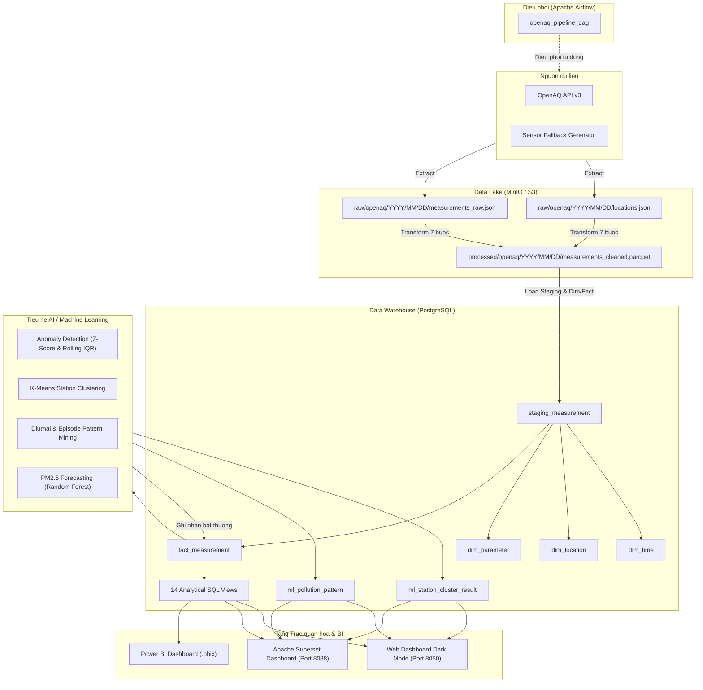

# TONG QUAN DU AN OPENAQ AIR QUALITY MONITORING VIETNAM

## 1. Gioi thieu du an

Du an **OpenAQ Air Quality Monitoring Vietnam** la mot he thong ky thuat du lieu va hoc may toan dien (End-to-End Data Engineering & Machine Learning System) duoc thiet ke de thu thap, xu ly, luu tru, phan tich va truc quan hoa du lieu chat luong khong khi theo thoi gian thuc tai cac tinh thanh va do thi trong diem cua Viet Nam (Ha Noi, TP. HCM, Da Nang, Hai Phong, Bien Hoa, Bac Ninh, Vinh, Thai Nguyen, Can Tho, Nha Trang, Da Lat).

He thong ho tro theo doi 6 thong so o nhiem tieu chuan quoc te theo quy dinh cua To chuc Y te The gioi (WHO) va Co quan Bao ve Moi truong Hoa Ky (US EPA):
- **PM2.5**: Bui min duong kinh duoi 2.5 micromet.
- **PM10**: Bui min duong kinh duoi 10 micromet.
- **O3**: Khi Ozone tang mat dat.
- **NO2**: Khi Nitrogen Dioxide.
- **SO2**: Khi Sulfur Dioxide.
- **CO**: Khi Carbon Monoxide.

---

## 2. Kien truc tong the he thong (Architecture)

He thong duoc to chuc theo mo hinh kien truc Data Lakehouse ket hop BI va AI/ML hien dai:



---

## 3. Luong xu ly du lieu (Data Pipeline Lifecycle)

Chu trinh xu ly du lieu duoc dong goi trong file dieu phoi [src/pipeline.py](file:///c:/Users/Tien%20Loc/Downloads/Project%20OpenAQ/OpenAQ-Project-Unified/src/pipeline.py) gom 4 giai doan:

### Giai doan 1: Thu thap du lieu (Extract)
- Mo ta trong [src/extract/openaq_client.py](file:///c:/Users/Tien%20Loc/Downloads/Project%20OpenAQ/OpenAQ-Project-Unified/src/extract/openaq_client.py) va [src/extract/s3_writer.py](file:///c:/Users/Tien%20Loc/Downloads/Project%20OpenAQ/OpenAQ-Project-Unified/src/extract/s3_writer.py).
- Thu thap danh sach tram do va chi so tung gio qua API OpenAQ v3. Truong hop chua cau hinh API key hoac mat ket noi mang, he thong tu dong kich hoat che do du lieu mo phong (Sensor Fallback) voi dac tinh vat ly chuan cua 12 tram tai Viet Nam.
- Luu toan bo du lieu tho duoi dang JSON vao Data Lake MinIO theo duong dan phan cap thoi gian: `raw/openaq/YYYY/MM/DD/`.

### Giai doan 2: Lam sach, Chuan hoa & Tinh AQI (Transform)
Quy trinh bien doi duoc thuc thi nghiem ngat qua 7 buoc tuan tu:
1. **Remove Duplicate**: Loai bo ban ghi trung lap hoan toan ve tram, thong so va thoi gian.
2. **Handle Missing**: Xu ly gia tri thieu thong tin vi tri, gia tri do hoac moc thoi gian.
3. **Validate Measurement**: Kiem tra gioi han vat ly hop le cua tung chat (loai bo gia tri am va gia tri vuot nguong toi da cua cam bien).
4. **Data Quality Validation**: Xuat bao cao thong ke chat luong du lieu ([src/analysis/data_validation.py](file:///c:/Users/Tien%20Loc/Downloads/Project%20OpenAQ/OpenAQ-Project-Unified/src/analysis/data_validation.py)).
5. **Normalize Location**: Chuan hoa ten thanh pho, dinh dang toa do vi do `[-90, 90]` va kinh do `[-180, 180]`.
6. **Convert Timezone**: Dong bo thoi gian ve chuan UTC va tinh toan `local_datetime` (UTC+7 cho Viet Nam).
7. **Calculate AQI**: Tinh chi so chat luong khong khi (AQI) va phan cap muc do o nhiem theo cong thuc tieu chuan US EPA ([src/transform/aqi_calculator.py](file:///c:/Users/Tien%20Loc/Downloads/Project%20OpenAQ/OpenAQ-Project-Unified/src/transform/aqi_calculator.py)).
- Du lieu sau khi lam sach duoc ghi xuong Data Lake duoi dinh dang Parquet toi uu: `processed/openaq/YYYY/MM/DD/measurements_cleaned.parquet`.

### Giai doan 3: Nap Kho du lieu (Load)
- Trien khai tai [src/load/staging_loader.py](file:///c:/Users/Tien%20Loc/Downloads/Project%20OpenAQ/OpenAQ-Project-Unified/src/load/staging_loader.py), [src/load/dimension_loader.py](file:///c:/Users/Tien%20Loc/Downloads/Project%20OpenAQ/OpenAQ-Project-Unified/src/load/dimension_loader.py), va [src/load/fact_loader.py](file:///c:/Users/Tien%20Loc/Downloads/Project%20OpenAQ/OpenAQ-Project-Unified/src/load/fact_loader.py).
- Doc du lieu Parquet da lam sach va nap vao bang dem `staging_measurement`.
- Dong bo va cap nhat cac bang chieu (Dimensions): `dim_parameter`, `dim_location`, `dim_time`.
- Nap du lieu vao bang su kien `fact_measurement` theo co che kiem tra trung lap khoa nghiep vu, sau do don sach bang staging.

### Giai doan 4: Phan tich & Hoc may (ML Analytics)
- Dieu phoi qua [src/analysis/analytics_runner.py](file:///c:/Users/Tien%20Loc/Downloads/Project%20OpenAQ/OpenAQ-Project-Unified/src/analysis/analytics_runner.py).
- Thuc thi dong thoi 4 module phan tich chuyen sau va cap nhat ket qua nguoc tro lai co so du lieu PostgreSQL.

---

## 4. Mo hinh du lieu kho Data Warehouse (Star Schema)

Kho du lieu PostgreSQL (`openaq_dw`) duoc thiet ke theo mo hinh Star Schema chuan:

### Cac bang chinh:
1. **`fact_measurement`**:
   - `measurement_key` (PK), `time_key` (FK), `location_key` (FK), `parameter_key` (FK).
   - `value`, `aqi`, `pollution_category`.
   - `is_anomaly` (BOOLEAN), `anomaly_score`, `anomaly_method`.
2. **`dim_location`**: `location_key` (PK), `source_location_id`, `location_name`, `city`, `country`, `latitude`, `longitude`, `timezone`.
3. **`dim_time`**: `time_key` (PK), `datetime_utc`, `local_date`, `hour`, `day_of_week`, `day_name`, `month`, `year`, `season`.
4. **`dim_parameter`**: `parameter_key` (PK), `parameter_name`, `display_name`, `unit`, `description`.
5. **`ml_station_cluster_result`**: Luu ket qua phan cum tram qua tung lan chay (cluster, label, avg_aqi, unhealthy_rate, anomaly_rate).
6. **`ml_pollution_pattern`**: Luu ket qua khai pha mau o nhiem theo gio, theo ngay, va cac dot o nhiem keo dai (episodes).

### He thong 14 SQL Views phuc vu BI & Bao cao:
- `vw_fact_enriched`: View mo rong day du giua Fact va 3 Dimensions.
- `vw_kpi_overview`: Tong hop so tram hoat dong, AQI trung binh, tong phep do, tong bat thuong.
- `vw_pollution_category_dist`: Ty le phan bo cac nhom muc o nhiem US EPA.
- `vw_pollutant_aqi_avg`: AQI trung binh cua tung loai chat o nhiem.
- `vw_city_top10_aqi`: Bang xep hang Top 10 thanh pho co AQI cao nhat.
- `vw_city_hourly_heatmap`: Ma tran nhiet AQI theo 24 gio cua cac do thi.
- `vw_city_pm25_hourly`: Xu huong nong do PM2.5 theo thoi gian cua tung thanh pho.
- `vw_station_map`: Toa do vi do, kinh do va chi so cua tung tram.
- `vw_station_ranking`: Xep hang so sanh AQI trung binh va cuc dai giua cac tram.
- `vw_anomaly_formatted`: Danh sach su co bat thuong kem muc do Canh bao va Theo doi.
- `vw_ml_station_clusters`: Ket qua phan cum K-Means cac tram do.
- `vw_daily_aqi_trend`, `vw_hourly_weekday_heatmap`, `vw_anomaly_alerts`.

---

## 5. Phan he AI / Machine Learning & Khai pha du lieu

1. **Phat hien diem bat thuong (Anomaly Detection)**:
   - File: [src/analysis/anomaly_detection.py](file:///c:/Users/Tien%20Loc/Downloads/Project%20OpenAQ/OpenAQ-Project-Unified/src/analysis/anomaly_detection.py)
   - Thuat toan: Tich hop Z-Score ($|Z| > 3$), IQR (khoang tu phan vi) va Rolling Window Z-Score danh gia su bien dong dot bien trong cac cua so 3-6 gio.
   - Muc dich: Nhan dien som hong hoc thiet bi cam bien va cac su co phat thai dot bien.

2. **Phan cum tram quan trac (K-Means Clustering)**:
   - File: [src/analysis/clustering.py](file:///c:/Users/Tien%20Loc/Downloads/Project%20OpenAQ/OpenAQ-Project-Unified/src/analysis/clustering.py)
   - Thuoc tinh: AQI trung binh, do lech chuan, AQI max, ty le gio cham nguong doc hai, ty le bat thuong.
   - Thuat toan: K-Means voi co che tu dong toi uu so cum bang Silhouette Score.
   - Muc dich: Nhom cac khu vuc co hanh vi o nhiem tuong dong de phuc vu hoach dinh chinh sach.

3. **Khai pha mau o nhiem (Pattern Mining)**:
   - File: [src/analysis/pattern_mining.py](file:///c:/Users/Tien%20Loc/Downloads/Project%20OpenAQ/OpenAQ-Project-Unified/src/analysis/pattern_mining.py)
   - Thuoc tinh: Mau gio cao diem (Diurnal pattern), su khac biet giua ngay trong tuan va cuoi tuan, nhan dien dot o nhiem keo dai (Pollution Episodes), phan tich tuong quan giua cac chat.

4. **Du bao chat luong khong khi (Air Quality Forecasting)**:
   - File: [src/analysis/forecasting.py](file:///c:/Users/Tien%20Loc/Downloads/Project%20OpenAQ/OpenAQ-Project-Unified/src/analysis/forecasting.py)
   - Thuat toan: Mo hinh hoc may Random Forest Regressor kem mo hinh co so Baseline Persistence.
   - Dac trung: Tao cac bien tre (`lag_1`, `lag_2`, `lag_24`), trung binh truot (`rolling_mean_6`, `rolling_mean_24`), gio, thu, cuoi tuan.
   - Do chinh xac thuc te dat: $R^2 = 0.876$, $MAE = 3.65$.

---

## 6. He thong Truc quan hoa & Dashboard

He thong cung cap 3 kenh truc quan hoa dap ung da dang nhu cau nguoi dung:

1. **Web Dashboard Dark Mode chuyen biet (Port 8050)**:
   - File: [src/dashboard/app.py](file:///c:/Users/Tien%20Loc/Downloads/Project%20OpenAQ/OpenAQ-Project-Unified/src/dashboard/app.py) va [src/dashboard/template.html](file:///c:/Users/Tien%20Loc/Downloads/Project%20OpenAQ/OpenAQ-Project-Unified/src/dashboard/template.html).
   - Cong nghe: Backend Python nhe (`http.server` + `psycopg2`), Frontend HTML5/CSS3 Grid, ECharts 5, Vector SVG Map Viet Nam (Hoang Sa, Truong Sa).
   - Bo cuc luoi 4 khoi (2x2):
     - Khoi 1: Tong quan chat luong khong khi (Gauge AQI toan quoc, 5 nhom muc o nhiem, so tram hoat dong, chat o nhiem cao nhat, thanh do AQI tung chat).
     - Khoi 2: Xu huong theo thoi gian (Line chart da thanh pho + Heatmap 24h).
     - Khoi 3: Theo vi tri (Ban do Viet Nam kem nhan noi + Bang xep hang Top 10 thanh pho).
     - Khoi 4: Du bao & canh bao (Duong du bao PM2.5 net dut kem vung sai so + Bang cac diem bat thuong).

2. **Apache Superset Dashboard (Port 8088)**:
   - Tu dong hoa qua [analytics/setup_superset_dashboard.py](file:///c:/Users/Tien%20Loc/Downloads/Project%20OpenAQ/OpenAQ-Project-Unified/analytics/setup_superset_dashboard.py).
   - Giao dien da duoc ap dung Custom CSS Dark Mode.
   - Gom 4 tabs nghiep vu: `Tong quan (Bo cuc 2x2)`, `Xu huong thoi gian`, `Theo vi tri`, `Du bao & canh bao`.

3. **Power BI Dashboard (.pbix)**:
   - File mau: [analytics/air_quality_dashboard.pbix](file:///c:/Users/Tien%20Loc/Downloads/Project%20OpenAQ/OpenAQ-Project-Unified/analytics/air_quality_dashboard.pbix) ket noi truc tiep vao PostgreSQL qua cac cau lenh trong [analytics/queries.sql](file:///c:/Users/Tien%20Loc/Downloads/Project%20OpenAQ/OpenAQ-Project-Unified/analytics/queries.sql).

---

## 7. Huong dan van hanh & Lenh thuong dung

### 7.1 Khoi dong toan bo he thong
```powershell
docker compose -f docker/docker-compose.yml up -d
```

### 7.2 Cac cong truy cap dich vu
- **Web Dashboard Dark Mode**: `http://localhost:8050`
- **Apache Superset**: `http://localhost:8088` (`admin` / `admin`)
- **Apache Airflow**: `http://localhost:8082` (`airflow` / `airflow`)
- **MinIO S3 Console**: `http://localhost:9001` (`minioadmin` / `minioadmin`)
- **PostgreSQL Database**: `localhost:5432/openaq_dw` (`postgres` / `postgres`)

### 7.3 Chay Pipeline thu cong qua Terminal
```powershell
docker exec openaq_airflow_scheduler python -m src.pipeline
```

### 7.4 Chay bo kiem thu don vi (Unit Tests)
```powershell
python -m unittest discover tests
```

### 7.5 Tam dung he thong an toan
```powershell
docker compose -f docker/docker-compose.yml stop
```
*(Luu y: Khong dung co `-v` de tranh xoa cac volume du lieu).*

---

## 8. Cau truc thu muc ma nguon

```
OpenAQ-Project-Unified/
├── .env.example                    # File cau hinh moi truong mau
├── .gitignore                      # Danh sach loai tru khoi Git
├── README.md                       # Huong dan tom tat
├── PROJECT_OVERVIEW.md             # Tai lieu tong quan toan bo kien truc du an
├── requirements.txt                # Cac thu vien phu thuoc Python
├── Implement/                      # Nhat ky va tien do trien khai chi tiet
│   ├── 2026-10-18.md
│   ├── 2026-10-27.md
│   └── project_plan.md
├── analytics/                      # Thu muc cau hinh Superset & Power BI
│   ├── air_quality_dashboard.pbix
│   ├── queries.sql
│   └── setup_superset_dashboard.py
├── dags/                           # Airflow DAGs
│   └── openaq_pipeline_dag.py
├── docker/                         # Cau hinh ha tang Container
│   ├── docker-compose.yml
│   └── init-multiple-dbs.sh
├── sql/                            # Script DDL kho du lieu & Views
│   ├── create_tables.sql
│   ├── analysis_queries.sql
│   └── migrations/
├── src/                            # Ma nguon ung dung chinh
│   ├── extract/                    # Tang thu thap (OpenAQ Client & S3 Writer)
│   ├── transform/                  # Tang lam sach, chuan hoa & tinh AQI
│   ├── load/                       # Tang nap Staging, Dim va Fact
│   ├── analysis/                   # Tang AI, Machine Learning & Khai pha
│   ├── dashboard/                  # Web Dashboard Dark Mode (app.py & template.html)
│   ├── utils/                      # Database connector, Logger, Config
│   └── pipeline.py                 # File dieu phoi tong the
└── tests/                          # 38 bo kiem thu don vi (Unit Tests)
```
