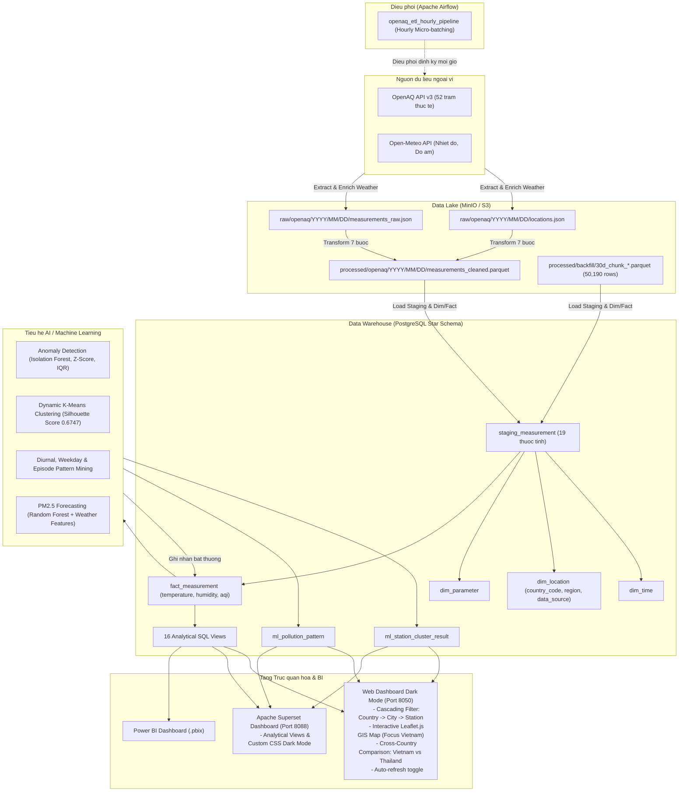

# TONG QUAN DU AN OPENAQ AIR QUALITY MONITORING (DONG NAM A - UU TIEN VIET NAM)

## 1. Gioi thieu du an

Du an **OpenAQ Air Quality Monitoring** la mot he thong ky thuat du lieu va hoc may toan dien (End-to-End Data Engineering & Machine Learning System) duoc thiet ke de thu thap, lam giau thoi tiet, xu ly, luu tru, phan tich va truc quan hoa du lieu chat luong khong khi theo thoi gian thuc tai 20 do thi lon thuoc khu vuc Dong Nam A (uu tien cac do thi trong diem cua Viet Nam: Ha Noi, TP. Ho Chi Minh va 18 do thi lon cua Thai Lan, tat ca deu trong cung mui gio UTC+7).

He thong giam sat 6 thong so o nhiem tieu chuan quoc te theo quy dinh cua To chuc Y te The gioi (WHO) va Co quan Bao ve Moi truong Hoa Ky (US EPA):
- **PM2.5**: Bui min duong kinh duoi 2.5 micromet.
- **PM10**: Bui min duong kinh duoi 10 micromet.
- **O3**: Khi Ozone tang mat dat.
- **NO2**: Khi Nitrogen Dioxide.
- **SO2**: Khi Sulfur Dioxide.
- **CO**: Khi Carbon Monoxide.

He thong duoc tich hop truc tiep voi **Open-Meteo API** de bo sung cac thong so khi tuong quan trong:
- **Temperature**: Nhiet do khong khi (do C).
- **Humidity**: Do am tuong doi (%).

---

## 2. Kien truc tong the he thong (Architecture)

He thong duoc to chuc theo mo hinh kien truc Data Lakehouse ket hop BI va AI/ML hien dai:



---

## 3. Luong xu ly du lieu (Data Pipeline Lifecycle)

Chu trinh xu ly du lieu duoc dong goi trong file dieu phoi [src/pipeline.py](file:///c:/Users/Tien%20Loc/Downloads/Project%20OpenAQ/OpenAQ-Project-Unified/src/pipeline.py) gom 4 giai doan:

### Giai doan 1: Thu thap du lieu & Lam giau khi tuong (Extract & Weather Enrichment)
- Mo ta trong [src/extract/openaq_client.py](file:///c:/Users/Tien%20Loc/Downloads/Project%20OpenAQ/OpenAQ-Project-Unified/src/extract/openaq_client.py) va [src/extract/weather_client.py](file:///c:/Users/Tien%20Loc/Downloads/Project%20OpenAQ/OpenAQ-Project-Unified/src/extract/weather_client.py).
- Doc danh muc 20 thanh pho, 52 tram quan trac thuc te tu [config/cities.yaml](file:///c:/Users/Tien%20Loc/Downloads/Project%20OpenAQ/OpenAQ-Project-Unified/config/cities.yaml).
- Thu thap du lieu do gio tu OpenAQ v3 API, dong thoi truy van Open-Meteo API theo toa do GPS va gio de tich hop nhiet do va do am.
- Luu toan bo du lieu tho vao Data Lake MinIO theo duong dan phan cap: `raw/openaq/YYYY/MM/DD/`.

### Giai doan 2: Lam sach, Chuan hoa & Tinh AQI (Transform)
Quy trinh bien doi duoc thuc thi nghiem ngat qua 7 buoc tuan tu:
1. **Remove Duplicate**: Loai bo ban ghi trung lap hoan toan ve tram, thong so va thoi gian.
2. **Handle Missing**: Xu ly gia tri thieu thong tin vi tri, gia tri do hoac moc thoi gian.
3. **Validate Measurement**: Kiem tra gioi han vat ly hop le cua tung chat (loai bo gia tri am va gia tri vuot nguong toi da cua cam bien).
4. **Data Quality Validation**: Xuat bao cao thong ke chat luong du lieu ([src/analysis/data_validation.py](file:///c:/Users/Tien%20Loc/Downloads/Project%20OpenAQ/OpenAQ-Project-Unified/src/analysis/data_validation.py)).
5. **Normalize Location**: Chuan hoa ten thanh pho, ma quoc gia (`country_code`), khu vuc (`region`), kiem tra toa do vi do `[-90, 90]` va kinh do `[-180, 180]`.
6. **Convert Timezone**: Dong bo thoi gian ve chuan UTC va tinh toan `local_datetime` (UTC+7).
7. **Calculate AQI**: Tinh chi so chat luong khong khi (AQI) va phan cap muc do o nhiem theo cong thuc tieu chuan US EPA ([src/transform/aqi_calculator.py](file:///c:/Users/Tien%20Loc/Downloads/Project%20OpenAQ/OpenAQ-Project-Unified/src/transform/aqi_calculator.py)).
- Du lieu sau khi lam sach duoc ghi xuong Data Lake duoi dinh dang Parquet toi uu: `processed/openaq/YYYY/MM/DD/measurements_cleaned.parquet`.

### Giai doan 3: Nap Kho du lieu (Load)
- Trien khai tai [src/load/staging_loader.py](file:///c:/Users/Tien%20Loc/Downloads/Project%20OpenAQ/OpenAQ-Project-Unified/src/load/staging_loader.py), [src/load/dimension_loader.py](file:///c:/Users/Tien%20Loc/Downloads/Project%20OpenAQ/OpenAQ-Project-Unified/src/load/dimension_loader.py), va [src/load/fact_loader.py](file:///c:/Users/Tien%20Loc/Downloads/Project%20OpenAQ/OpenAQ-Project-Unified/src/load/fact_loader.py).
- Doc du lieu Parquet da lam sach va nap vao bang dem `staging_measurement` (19 thuoc tinh).
- Dong bo va cap nhat cac bang chieu (Dimensions): `dim_parameter`, `dim_location` (kem `country_code`, `region`), `dim_time`.
- Nap du lieu vao bang su kien `fact_measurement` (kem `temperature`, `humidity`), sau do don sach bang staging.

### Giai doan 4: Phan tich & Hoc may (ML Analytics)
- Dieu phoi qua [src/analysis/analytics_runner.py](file:///c:/Users/Tien%20Loc/Downloads/Project%20OpenAQ/OpenAQ-Project-Unified/src/analysis/analytics_runner.py).
- Thuc thi dong thoi 4 module phan tich chuyen sau va cap nhat ket qua nguoc tro lai co so du lieu PostgreSQL.

---

## 4. Mo hinh du lieu kho Data Warehouse (Star Schema)

Kho du lieu PostgreSQL (`openaq_dw`) duoc thiet ke theo mo hinh Star Schema chuan:

### Cac bang chinh:
1. **`fact_measurement`**:
   - `measurement_key` (PK), `time_key` (FK), `location_key` (FK), `parameter_key` (FK).
   - `value`, `aqi`, `pollution_category`.
   - `temperature` (DOUBLE PRECISION), `humidity` (DOUBLE PRECISION).
   - `is_anomaly` (BOOLEAN), `anomaly_score`, `anomaly_method`.
2. **`dim_location`**: `location_key` (PK), `source_location_id`, `location_name`, `city`, `country`, `country_code`, `region`, `data_source`, `latitude`, `longitude`, `timezone`.
3. **`dim_time`**: `time_key` (PK), `datetime_utc`, `local_date`, `hour`, `day_of_week`, `day_name`, `month`, `year`, `season`.
4. **`dim_parameter`**: `parameter_key` (PK), `parameter_name`, `display_name`, `unit`, `description`.
5. **`ml_station_cluster_result`**: Luu ket qua phan cum tram qua tung lan chay (cluster, label, avg_aqi, unhealthy_rate, anomaly_rate).
6. **`ml_pollution_pattern`**: Luu ket qua khai pha mau o nhiem theo gio, theo ngay, va cac dot o nhiem keo dai (episodes).

### He thong 16 SQL Views phuc vu BI & Bao cao:
- `vw_fact_enriched`: View mo rong day du giua Fact va 3 Dimensions (day du country, region, temp, humidity).
- `vw_kpi_overview`: Tong hop so tram hoat dong, AQI trung binh, tong phep do, tong bat thuong.
- `vw_country_comparison`: So sanh doi chuan truc tiep giua cac quoc gia (Viet Nam vs Thai Lan).
- `vw_region_comparison`: Thong ke chi so trung binh theo tung vung mien.
- `vw_station_map`: Toa do vi do, kinh do, thoi tiet va chi so cua tung tram.
- `vw_pollution_category_dist`: Ty le phan bo cac nhom muc o nhiem US EPA.
- `vw_pollutant_aqi_avg`: AQI trung binh cua tung loai chat o nhiem.
- `vw_city_top10_aqi`: Bang xep hang Top cac thanh pho co AQI cao nhat.
- `vw_city_hourly_heatmap`: Ma tran nhiet AQI theo 24 gio cua cac do thi.
- `vw_anomaly_formatted`: Danh sach su co bat thuong kem muc do Canh bao va Theo doi.
- `vw_ml_station_clusters`: Ket qua phan cum K-Means cac tram do.
- `vw_daily_aqi_trend`, `vw_hourly_weekday_heatmap`, `vw_station_ranking`...

---

## 5. Phan he AI / Machine Learning & Khai pha du lieu

1. **Phat hien diem bat thuong (Anomaly Detection)**:
   - File: [src/analysis/anomaly_detection.py](file:///c:/Users/Tien%20Loc/Downloads/Project%20OpenAQ/OpenAQ-Project-Unified/src/analysis/anomaly_detection.py)
   - Thuat toan: Tich hop Z-Score ($|Z| > 3$), IQR va Isolation Forest tren du lieu thuc te.
   - Ket qua thuc te: Phat hien va luu tru 5,229 ban ghi bat thuong.

2. **Phan cum tram quan trac (K-Means Clustering)**:
   - File: [src/analysis/clustering.py](file:///c:/Users/Tien%20Loc/Downloads/Project%20OpenAQ/OpenAQ-Project-Unified/src/analysis/clustering.py)
   - Thuoc tinh: AQI trung binh, do lech chuan, AQI max, ty le gio doc hai, ty le bat thuong, nhiet do va do am.
   - Thuat toan: K-Means voi co che tu dong tim K toi uu bang Silhouette Score.
   - Ket qua thuc te: Chon K=2 voi **Silhouette Score dat 0.6747** (do tach cum rat cao).

3. **Khai pha mau o nhiem (Pattern Mining)**:
   - File: [src/analysis/pattern_mining.py](file:///c:/Users/Tien%20Loc/Downloads/Project%20OpenAQ/OpenAQ-Project-Unified/src/analysis/pattern_mining.py)
   - Trinh xuat 1,588 mau hinh gio cao diem, 481 mau hinh ngay trong tuan va 78 dot o nhiem keo dai.

4. **Du bao chat luong khong khi (Air Quality Forecasting)**:
   - File: [src/analysis/forecasting.py](file:///c:/Users/Tien%20Loc/Downloads/Project%20OpenAQ/OpenAQ-Project-Unified/src/analysis/forecasting.py)
   - Thuat toan: Random Forest Regressor da bien tich hop dac trung tre thoi gian va khi tuong.
   - Ket qua kiem dinh tren 22,758 mau thuc te:
     - **Random Forest MAE: 1.27 | RMSE: 10.77 | R2: 0.640** (giam 23.2% RMSE so voi Baseline).
     - **Tam quan trong dac trung**: `lag_1` (0.7738), `temperature` (0.1012 - Rank 2), `rolling_mean_6` (0.0474), `humidity` (0.0374 - Rank 4).

---

## 6. He thong Truc quan hoa & Dashboard

1. **Web Dashboard Dark Mode chuyen biet (Port 8050)**:
   - File: [src/dashboard/app.py](file:///c:/Users/Tien%20Loc/Downloads/Project%20OpenAQ/OpenAQ-Project-Unified/src/dashboard/app.py) va [src/dashboard/template.html](file:///c:/Users/Tien%20Loc/Downloads/Project%20OpenAQ/OpenAQ-Project-Unified/src/dashboard/template.html).
   - **Bo loc da tang (Cascading Filters)**: Quoc gia (`countryFilter`) -> Do thi (`cityFilter`) -> Tram quan trac (`stationFilter`).
   - **Ban do dia ly tuong tac (Leaflet.js GIS)**:
     - Lop nen toi CartoDB Dark Matter.
     - Mac dinh tap trung truc tiep vao **Viet Nam** (`center: [16.04, 107.5]`, `zoom: 6`).
     - Marker vong tron mau EPA AQI cho 38 tram quan trac thuc te.
     - Popup chi tiet kem day du chi so AQI, PM2.5, Nhiet do (°C) va Do am (%).
   - **The so sanh doi chuan Quoc gia (Cross-Country Comparison)**: So sanh song song giua Viet Nam va Thai Lan.
   - **Auto-refresh**: Chon tan suat tu dong lam moi (30s, 1 phut, 5 phut).

2. **Apache Superset Dashboard (Port 8088)**:
   - Dashboard BI quan tri 4 tabs (Tong quan, Xu huong, Vi tri, Du bao & canh bao).
   - Truy van truc tiep cac View moi `vw_fact_enriched`, `vw_country_comparison`, `vw_region_comparison`.

3. **Power BI Dashboard (.pbix)**:
   - File mau: [analytics/air_quality_dashboard.pbix](file:///c:/Users/Tien%20Loc/Downloads/Project%20OpenAQ/OpenAQ-Project-Unified/analytics/air_quality_dashboard.pbix).

---

## 7. Huong dan van hanh

### 7.1 Khoi dong he thong
```powershell
docker compose -f docker/docker-compose.yml up -d
```

### 7.2 Cac cong truy cap dich vu
- **Web Dashboard Dark Mode**: `http://localhost:8050`
- **Apache Superset**: `http://localhost:8088` (`admin` / `admin`)
- **Apache Airflow**: `http://localhost:8082` (`airflow` / `airflow`)
- **MinIO S3 Console**: `http://localhost:9001` (`minioadmin` / `minioadmin`)
- **PostgreSQL Database**: `localhost:5432/openaq_dw` (`postgres` / `postgres`)

### 7.3 Chay Pipeline micro-batching qua Terminal
```powershell
docker exec openaq_airflow_scheduler python -m src.pipeline
```

### 7.4 Chay kiem thu don vi (Unit Tests)
```powershell
python -m unittest discover tests
```

---

## 8. Cau truc thu muc ma nguon

```
OpenAQ-Project-Unified/
|-- config/
|   |-- cities.yaml                # Danh muc 20 thanh pho, 52 tram quan trac thuc te
|   `-- backfill_checkpoint.json   # Checkpoint luu trang thai thu thap 30 ngay
|-- scripts/
|   |-- discover_stations.py       # Script khao sat OpenAQ v3 tim kiem tram thuc te
|   `-- backfill_30d.py            # Script backfill 30 ngay theo chunk kem thoi tiet
|-- dags/                          # Airflow DAGs dinh ky
|   `-- openaq_pipeline_dag.py     # DAG micro-batching theo gio (openaq_etl_hourly_pipeline)
|-- docker/
|   |-- docker-compose.yml         # Cau hinh toan bo containers
|   `-- init-multiple-dbs.sh       # Script khoi tao nhieu database trong Postgres
|-- sql/
|   |-- create_tables.sql          # DDL Star Schema DWH, bang ML va toan bo Views
|   `-- analysis_queries.sql       # Cac cau truy van phan tich chuyen sau
|-- src/
|   |-- extract/                   # OpenAQ API v3 client & WeatherClient (Open-Meteo)
|   |-- transform/                 # 7 buoc lam sach du lieu va tinh AQI US EPA
|   |-- load/                      # Nap du lieu Staging, Dimensions, Fact
|   |-- analysis/                  # Phan he AI/ML: Anomaly Detection, K-Means, Pattern Mining, Forecast
|   |-- dashboard/                 # Web Dashboard Dark Mode (app.py & template.html)
|   |-- utils/                     # Ket noi CSDL, MinIO, cau hinh, ghi log
|   `-- pipeline.py                # File dieu phoi toan bo luong thuc thi
|-- tests/                         # 43 bo kiem thu don vi (Unit Tests cho ETL, Schema & ML)
|-- Implement/                     # Nhat ky va tien do trien khai tung phien
|-- PROJECT_OVERVIEW.md            # Tai lieu tong quan toan bo kien truc du an
|-- requirements.txt               # Danh sach thu vien tong hop
|-- .env.example                   # Mau bien moi truong
`-- README.md                      # Tai lieu huong dan du an
```
